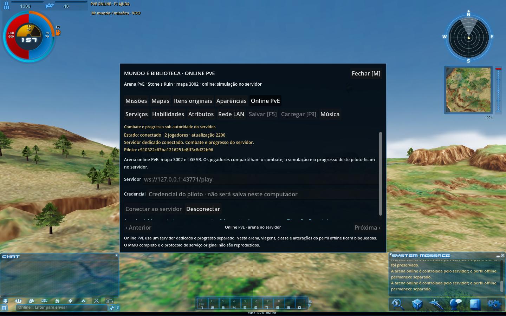

# ACE Modern

Modernização de AirRivals/Ace Online para **macOS (Apple Silicon e Intel)** e **Windows x64**, com Godot **4.7.2**. A versão **0.8.0** acrescenta uma sala PvE com servidor autoritativo: dois pilotos compartilham inimigos, disparos, dano, habilidades e recompensas no mapa 3002, usando I-GEAR.

[Baixar versão 0.8](https://github.com/gbmlima-bot/AceOnline-ep43/releases/tag/ace-modern-v0.8.0) · [Instalar e operar o servidor](docs/ONLINE-PVE.md) · [Evidências dos testes](verification/)



A captura acima mostra o conteúdo do pacote Mac executado pelo Godot em Linux, conectado a um servidor real. A execução nativa dos aplicativos em macOS e Windows ainda está pendente. Não há servidor público provisionado.

## Downloads e fontes completos

Os aplicativos macOS/Windows, o kit do servidor e os fontes completos com assets estão disponíveis na [Release ACE Modern 0.8.0](https://github.com/gbmlima-bot/AceOnline-ep43/releases/tag/ace-modern-v0.8.0). O código está na branch `ace-modern`; a branch `main` do código legado foi preservada.

Baixe na Release o manifesto e todas as partes do pacote escolhido: [`macOS`](https://github.com/gbmlima-bot/AceOnline-ep43/releases/download/ace-modern-v0.8.0/ace-modern-online-macos-v0.8.zip.parts.json), [`Windows`](https://github.com/gbmlima-bot/AceOnline-ep43/releases/download/ace-modern-v0.8.0/ace-modern-online-windows-v0.8.zip.parts.json) ou [`fontes completos`](https://github.com/gbmlima-bot/AceOnline-ep43/releases/download/ace-modern-v0.8.0/ace-modern-fontes-v0.8.zip.parts.json). A ferramenta [`release_parts.py`](https://github.com/gbmlima-bot/AceOnline-ep43/releases/download/ace-modern-v0.8.0/release_parts.py) recompõe os arquivos grandes. O [`kit do servidor`](https://github.com/gbmlima-bot/AceOnline-ep43/releases/download/ace-modern-v0.8.0/ace-online-kit-v0.8.zip) é um ZIP único.

Os pacotes grandes estão divididos em partes de até 1,5 GB para respeitar o limite de 2 GB por arquivo do GitHub. Os manifestos registram tamanhos e hashes SHA256 para conferir cada parte e o ZIP completo.

Para um pacote dividido, baixe seu arquivo `.parts.json`, **todas** as partes `.part-001`, `.part-002` etc. e `release_parts.py` para a mesma pasta. Use Python 3.11 ou mais recente:

```sh
python3 release_parts.py restore ace-modern-online-macos-v0.8.zip.parts.json --output ace-modern-online-macos-v0.8.zip
```

Troque o nome por `ace-modern-online-windows-v0.8.zip` ou `ace-modern-fontes-v0.8.zip`, conforme o pacote escolhido. A ferramenta verifica cada parte e o SHA256 do ZIP completo antes de disponibilizar o resultado. Depois extraia o ZIP normalmente. O kit `ace-online-kit-v0.8.zip` pode ser baixado e extraído diretamente.

Para obter o código já publicado:

```sh
git clone --single-branch --branch ace-modern https://github.com/gbmlima-bot/AceOnline-ep43.git ace-modern
```

O histórico Git mantém os fontes, ferramentas, documentação e os dados numéricos necessários ao servidor. Os gigabytes de modelos, texturas e áudio ficam no ZIP completo da Release. Para editar o cliente gráfico, extraia **`ace-modern-fontes-v0.8.zip`** e abra `ace-modern/client/project.godot` no Godot 4.7.2. Essa extração já é a versão 0.8: não precisa aplicar o overlay 0.7 → 0.8 do kit. A primeira abertura importa os assets.

## Servidor enxuto

Um processo Godot headless executa a sala, SQLite/WAL persiste os pilotos e Caddy publica `wss://SEU-DOMINIO/play`. Docker Compose inclui limites de recursos, volumes persistentes, scripts para criar/rotacionar credenciais e backup/restauração consistente. O servidor usa dados numéricos de terreno e colisões, sem carregar arte ou exigir GPU.

Comece pelo `server-bundle/` do kit da Release. Para teste local, dentro dessa pasta:

```sh
cp .env.example .env
export COMPOSE_FILE=compose.yaml:compose.local.yaml
docker compose build game
docker compose up -d game
curl --fail http://127.0.0.1:9081/readyz
./scripts/create-pilot.sh "Piloto1"
```

No cliente 0.8: **M → Online PvE**, URL `ws://127.0.0.1:9080/play`, credencial do piloto e **Conectar ao servidor**. Cada pessoa recebe uma credencial própria. No Mac M4, o servidor Linux amd64 pode usar emulação do Docker Desktop.

Para publicação, um ponto de partida é VPS **Linux amd64, 2 vCPU, 4 GB de RAM e SSD**, com domínio e TCP 80/443 liberados. O [guia completo](docs/ONLINE-PVE.md) explica DNS, TLS, credenciais, atualização e recuperação de backups. Isso é uma configuração inicial, sem benchmark de capacidade.

Para reconstruir somente a aplicação do servidor a partir deste checkout Git:

```sh
python3 tools/build_server_bundle.py --source . --output build/server-app --app-only
```

O bundle completo também exige o binário oficial Godot Linux x86_64 cujo SHA256 está fixado no gerador. Os arquivos `.env` reais, credenciais, bancos, backups, caches e builds são ignorados pelo Git.

## Alcance e validação

O servidor calcula voo, colisões, munição, habilidades, morte/respawn e recompensas. O progresso online é separado do perfil offline. O encontro de três inimigos e os 10 SPI por inimigo para cada participante são regras locais identificadas; o banco original de spawns e drops não foi recuperado.

Campanha online, economia compartilhada, PvP, guildas, facções e múltiplos mapas persistentes continuam pendentes. O limite configurável de oito pilotos não foi validado com teste de carga; o ponto de partida é dois jogadores. O cliente oficial e a versão 0.7 não conectam a este protocolo.

Os testes incluem cliente real com dois pilotos e servidor separado, reconexão, persistência, transações, TLS/WSS via Caddy, Docker, backup/restauração e encerramento gracioso. Os recursos dos pacotes Mac e Windows foram executados em Linux, com renderização e 40 verificações online em cada pacote. Não houve execução nativa em macOS/Windows nem implantação em VPS público.

A atualização foi aplicada sobre uma extração completa da base 0.7: 45.579 assets preservados, 256 arquivos de overlay conferidos e 47 arquivos do servidor reconstruídos idênticos ao bundle aprovado. Relatórios em [verification/](verification/).

Avisos e proveniência de Godot, godot-sqlite, fonte Noto e ferramentas estão em [third_party/](third_party/). Os avisos das dependências não concedem uma licença geral aos recursos originais de Ace Online/AirRivals.
